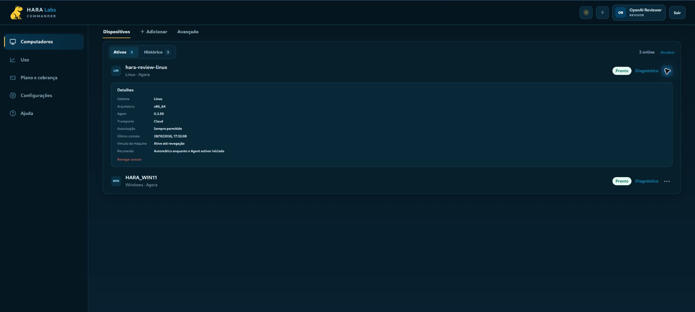

# Ubuntu QA migrado para produção — 28/10/2026

**PASS_LINUX_PRODUCTION_MIGRATION às 17:32:48 Brasília (20:32:48Z).**

A pedido explícito de Tiago, a instalação existente da VM `hara-review-linux`, na Sentinela B, foi migrada de DEV para `https://commander.haralabs.com.br`. A conta local continua `commanderqa` (UID 2000); o código de pareamento foi gerado pela sessão autenticada **OpenAI Reviewer** no portal de produção.

## Alvo e resultado

- Domínio libvirt: `d7a27a4a-41c3-4c14-a84e-187443566a3c`, nome e estado ativo verificados antes das chamadas QGA.
- Agent preservado: **0.3.59**, 265620 bytes, SHA-256 `df8b2d09c5447f8d405200538a841e669a8f165e9043701d6c8efcbfe5a34d38`.
- Manifesto .59 SHA-256 `efe39839596883875358cfc27cd7ec62c0d38acc3c03708df56034a82d35d7b4`: assinatura RS256 v2 verificada localmente contra a chave pública previamente fixada.
- Novo dispositivo PROD: `HARA-DEVICE-f71629a0-de92-48e0-aa2b-f70c2c82dc6b`.
- Runtime novo: 20:32:09.169300Z; heartbeat autenticado: 20:32:09.637794Z, HTTP 200, sem erro de runtime no recibo.
- Serviço ativo; Agent e unidade preservados; política `PERSISTENT_TRUSTED` e transporte `OUTBOUND_RELAY` mantidos.
- Portal Reviewer: Linux **Pronto**, Agent **0.3.59**, e Windows existente também visível. A captura mostra o resultado observado.
- Vínculo DEV antigo `HARA-DEVICE-962202bc-274a-486b-9794-b73d9f3a5889` revogado com sucesso somente após comprovação de produção.

A execução ocorreu **dentro da VM Linux na Sentinela B**, via Commander principal e o canal administrativo QGA já disponível, como o usuário limitado `commanderqa`. O navegador conectado do Núcleo A foi usado para o portal de pareamento. Não foi necessário abrir ChatGPT na VM.

## Procedimento e preservação

O helper administrativo verifica os bytes exatos do Agent instalado e cria preimagem privada da configuração; valida a credencial nova no servidor antes de parar o serviço; troca somente origem, ID e token; inicia e exige runtime e heartbeat novos. A implementação existente do Agent separa bancos, filas e recibos por origem e identidade do enrollment. O histórico DEV foi preservado, sem edição de bancos ou replay. Não havia chamadas pendentes no journal observado antes da troca.

Preimagens e credenciais ficam exclusivamente no diretório privado da conta dentro da VM: `~/.local/share/hara-commander-connect-qa/migration-prod-20261028/`. Nenhum código de pareamento, token de dispositivo ou configuração privada está neste commit. O helper é uma operação administrativa específica desta migração; não representa uma nova funcionalidade assinada do instalador público.

## Tentativa inicial preservada

Às 20:29:53Z o primeiro cadastro foi aceito pelo servidor com HTTP 201, mas o helper inicial exigia HTTP 200 e interrompeu antes de alterar a configuração ou o serviço. Sua credencial não foi persistida. O cadastro incompleto, matrícula terminada em **632fb672**, foi revogado pela UI legítima do Reviewer e movido para Histórico. O helper R2 aceita o status documentado 201 exclusivamente no enrollment; heartbeat e revoke continuam exigindo 200. A tentativa seguinte concluiu a migração. O recibo de falha original permanece na VM e no JSON de evidência.

## Verificação e limites

- Compilação Python passou. Um teste sintético de falha na inicialização comprovou restauração exata da configuração DEV, reinício do serviço e revogação da credencial nova; não é um teste de restauração de VM.
- A conexão em produção e o estado no portal são nativos. O botão Diagnóstico do portal apenas copiou o comando; não houve execução funcional pelo MCP Reviewer nesta etapa.
- A distribuição pública de instaladores/manifestos não foi promovida. Esta entrega migra somente a instalação Linux QA existente para produção.
- As pendências operacionais Windows e de lançamento público do fechamento anterior permanecem fora desta migração.

